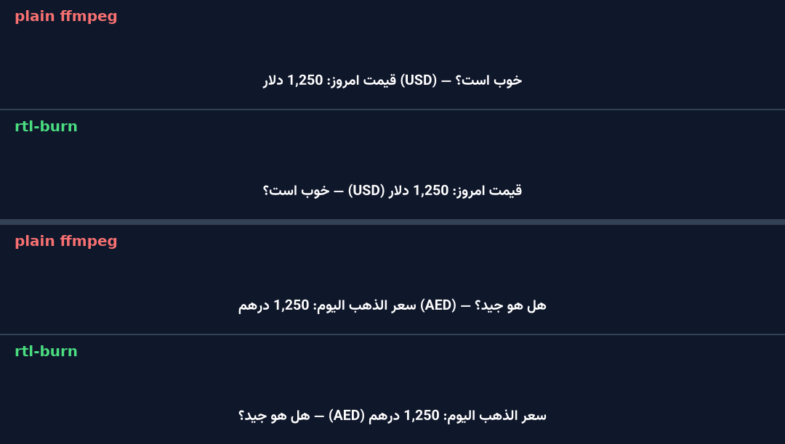

# rtl-burn

**Burn Persian, Arabic, Urdu and Hebrew subtitles into video with ffmpeg — without punctuation jumping to the wrong side or words getting reordered.**

[English](#english) · [فارسی](#فارسی) · [العربية](#العربية)



## English

### The problem

ffmpeg's `subtitles` filter uses libass, which lays out every line left-to-right. For right-to-left languages that breaks:

- the full stop or question mark at the end of a sentence appears at the **start**,
- lines mixing RTL text with numbers, Latin words or brackets get **shuffled** (see the image above),
- the usual workarounds (reversing strings, reshaping libraries) break joining or kerning.

### The fix

`rtl-burn` wraps every RTL line in Unicode directional embeddings (`U+202B … U+202C`), which libass respects. Shaping and letter-joining stay with HarfBuzz, so text looks exactly as intended. Lines that are pure English are left untouched, so bilingual subtitles work too.

### Install

Requires Python 3.9+ and ffmpeg built with libass (the default in most builds).

```bash
pip install git+https://github.com/mohammadhadijavidi/rtl-burn
```

### Usage

```bash
# Burn subtitles (audio is copied untouched)
rtl-burn video.mp4 subs.srt -o out.mp4 --font Vazirmatn --fonts-dir ./fonts

# Just fix the subtitle file, for players or other editors
rtl-burn subs.srt --fix-only subs.fixed.srt

# Check one frame before rendering the whole video
rtl-burn video.mp4 subs.srt --preview 12.5 -o frame.png
```

| Option | What it does |
| --- | --- |
| `--font NAME` | Font family, e.g. `Vazirmatn`, `Noto Naskh Arabic`, `Noto Sans Hebrew` |
| `--fonts-dir DIR` | Folder with `.ttf`/`.otf` files to load |
| `--size N` | Font size (SRT/VTT) |
| `--style "..."` | Any extra ASS style, e.g. `Outline=2,PrimaryColour=&H00FFFFFF` |
| `--direction auto\|rtl\|ltr` | `auto` fixes lines containing RTL letters (default); `rtl` forces all; `ltr` removes marks |
| `--crf N` / `--preset P` | H.264 quality and speed (default 20 / veryfast) |
| `--preview SEC` | Render a single PNG frame at that second |
| `--dry-run` | Print the ffmpeg command without running it |

Supported formats: `.srt`, `.vtt`, `.ass`, `.ssa`. Legacy Windows-1256 files are decoded automatically.

### Use it as a library

```python
from rtl_burn import fix_subtitles

fixed = fix_subtitles(open("subs.srt", encoding="utf-8").read(), "srt")
```

Running a fix twice is safe; it never doubles the marks.

### Fonts

Free fonts that work well: [Vazirmatn](https://github.com/rastikerdar/vazirmatn) (Persian), [Noto Naskh Arabic](https://fonts.google.com/noto/specimen/Noto+Naskh+Arabic) and [Noto Sans Arabic](https://fonts.google.com/noto/specimen/Noto+Sans+Arabic) (Arabic, Urdu), [Noto Sans Hebrew](https://fonts.google.com/noto/specimen/Noto+Sans+Hebrew).

## فارسی

### مشکل چیه؟

وقتی با ffmpeg زیرنویس فارسی رو روی ویدیو می‌سوزونی، نقطه و علامت سؤال آخر جمله میره اول خط. اگه توی جمله عدد یا کلمه‌ی انگلیسی باشه، ترتیب کلمه‌ها کلاً به‌هم می‌ریزه (عکس بالا رو ببین).

### rtl-burn چی کار می‌کنه؟

جهت هر خط فارسی رو با علامت‌های استاندارد یونیکد درست می‌کنه. اتصال حروف و فونت دست نمی‌خوره. خط‌های انگلیسی هم همون‌طور می‌مونن، پس زیرنویس دوزبانه هم مشکلی نداره.

### نصب و استفاده

۱. پایتون و ffmpeg رو نصب کن.
۲. این دستور رو بزن:

```bash
pip install git+https://github.com/mohammadhadijavidi/rtl-burn
```

۳. زیرنویس رو روی ویدیو بسوزون:

```bash
rtl-burn video.mp4 zirnevis.srt -o khoroji.mp4 --font Vazirmatn --fonts-dir ./fonts
```

اگه فقط فایل زیرنویس درست‌شده رو می‌خوای (مثلاً برای پریمیر یا کپ‌کات):

```bash
rtl-burn zirnevis.srt --fix-only zirnevis-dorost.srt
```

فونت پیشنهادی: [وزیرمتن](https://github.com/rastikerdar/vazirmatn). فایل‌های قدیمی با انکودینگ ویندوز (۱۲۵۶) هم خودکار درست خونده می‌شن.

## العربية

### المشكلة

عند حرق الترجمة العربية على الفيديو باستخدام ffmpeg، تنتقل علامات الترقيم في نهاية الجملة إلى بدايتها، وتختلط الكلمات عند وجود أرقام أو كلمات إنجليزية في السطر.

### الحل

يضبط `rtl-burn` اتجاه كل سطر عربي باستخدام علامات يونيكود القياسية، مع الحفاظ على تشكيل الحروف واتصالها. الأسطر الإنجليزية تبقى كما هي، لذلك تعمل الترجمات ثنائية اللغة أيضاً.

### التثبيت والاستخدام

```bash
pip install git+https://github.com/mohammadhadijavidi/rtl-burn
rtl-burn video.mp4 subs.srt -o out.mp4 --font "Noto Naskh Arabic"
```

لإصلاح ملف الترجمة فقط دون حرقه:

```bash
rtl-burn subs.srt --fix-only subs.fixed.srt
```

## Contributing

Issues and pull requests are welcome, especially sample subtitle lines that still render wrong. Run the tests with:

```bash
pip install -e ".[dev]" && pytest
```

## License

MIT © Mohammad Hadi Javidi
